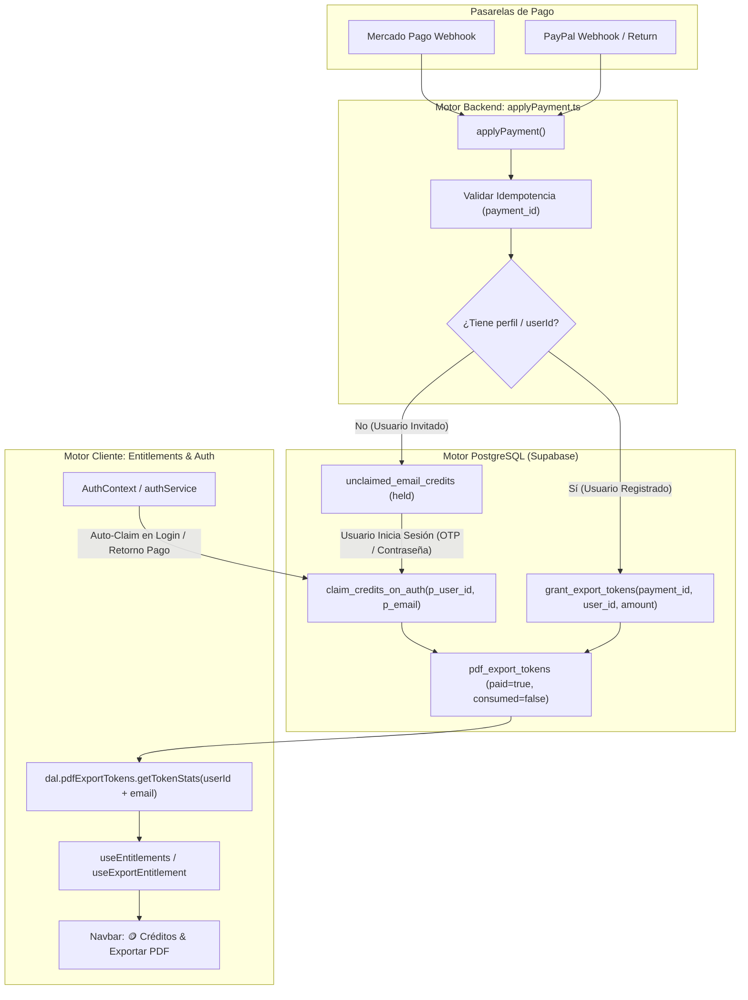

# Plan Integral: Autenticación, Landing Page y Motor Canónico de Acreditación de Créditos de Pago

## 1. Diagnóstico del Problema

1. **Falta de botón de ingreso en la Landing Page**:
   - `LandingPage.tsx` no contaba con un acceso directo para "Iniciar sesión" o "Mi cuenta", impidiendo a usuarios preexistentes ingresar a su cuenta antes de entrar al editor.

2. **Registro de usuarios sin persistencia de sesión inmediata**:
   - `LoginModal.tsx` cerraba el modal asumiendo que `signup()` iniciaba sesión, aun cuando Supabase requería confirmación de email (`session === null`).
   - `AuthContext.tsx` no seteaba de forma síncrona `setUser` en `initAuth`, dependiendo del evento asíncrono de Supabase.

3. **Extracción de PDF con IA con falso bloqueo de sesión**:
   - `ImportCvAiModal.tsx` abortaba la extracción con error si `getSession()` era null, contradiciendo la política canónica de LEECV donde la IA de importación es gratuita y libre con rate limiting por IP en backend.

4. **Desconexión entre el Motor de Visualización y el Motor de Consumo de Créditos**:
   - `getTokenStats` en el DAL filtraba únicamente por `email`, mientras que el motor de exportación (`check_and_consume_export_entitlement`) valida por `user_id = auth.uid()`.
   - `useEntitlements.ts` no sincronizaba el balance de créditos reactivamente tras el consumo o retorno de pasarelas de pago.

---

## 2. Arquitectura de Núcleo y Motor: Flujo Canónico de Pagos y Créditos

### Los 4 Caminos Canónicos de Acreditación (Sin Parches)

1. **Camino A: Usuario Registrado compra Pack (5 o 10 PDFs)**:
   - Webhook recibe `externalId` y `userId` (o email con perfil existente).
   - Invoca la función RPC transaccional `grant_export_tokens(payment_id, user_id, amount)`.
   - Se registra en `pdf_export_token_grants` (idempotencia a prueba de reintentos duplicados).
   - Se insertan $N$ filas en `pdf_export_tokens` con `paid = true, consumed = false, user_id = user_id`.
   - El cliente recibe el evento y actualiza el contador de créditos de inmediato.

2. **Camino B: Usuario Invitado compra Pack (Bolsillo de Reclamo)**:
   - Webhook recibe pago de invitado (no hay perfil aún).
   - `applyPayment.ts` guarda los créditos en `unclaimed_email_credits` con `email = lower(email.trim())`, `status = held`.
   - Despacha alerta WhatsApp al admin (+5493878342772).
   - Cuando el cliente inicia sesión (vía OTP de 6 dígitos o registro tradicional), `claimCreditsOnAuth` ejecuta la RPC `claim_credits_on_auth`:
     - Mueve en una sola transacción los créditos a `pdf_export_tokens` con el `user_id` recién autenticado.
     - Sella las filas en `unclaimed_email_credits`.
     - Actualiza el balance en la pantalla sin recargar la página.

3. **Camino C: Usuario compra 1 PDF individual (Single Token)**:
   - Se genera el token único vía `dal.createUnpaidToken()` o RPC `create_guest_export_token`.
   - El pago marca el token como `paid = true`.
   - Al autenticarse con ese mismo email en el futuro, `claim_credits_on_auth` vincula automáticamente el token a su cuenta (`UPDATE pdf_export_tokens SET user_id = v_user_id WHERE email = v_auth_email`).

4. **Camino D: Acreditación Administrativa Manual**:
   - Desde el panel `/admin`, el administrador busca al cliente por email.
   - Presiona `+1`, `+5` o `+10` créditos con motivo obligatorio.
   - Invoca de forma segura `grant_export_tokens(payment_id, user_id, amount, email)`.
   - El usuario ve reflejado el nuevo saldo en su cuenta al instante.

---

## 3. Plan de Conexión de Núcleo en el Código

- **Paso 1: Unificación de `getTokenStats` en el DAL (`dataAccessLayer.ts`)**:
  - Aceptar `{ userId?: string; email?: string }`.
  - Consultar unificadamente por `user_id` o `email` (`.or("user_id.eq.${userId},email.eq.${email}")`).
  - Esto garantiza que tanto tokens acreditados por UUID como tokens de invitado asociados por correo sean computados sin discrepancias.

- **Paso 2: Conexión Reactiva en `useEntitlements.ts`**:
  - `refreshEntitlements()` debe refrescar concurrentemente los derechos de exportación (`useExportEntitlement`) y las estadísticas de tokens (`getTokenStats`).
  - Al invocar `consumeExport()`, recalcular el balance localmente para que el contador visual en el Navbar baje inmediatamente.

- **Paso 3: Sincronización en Retorno de Pasarelas (`App.tsx`)**:
  - En `procesarRetornoPago()`, tras confirmar `paypal_captured` o `payment_success`, invocar `claimCreditsOnAuth(user)` y `refreshEntitlements()`.

---

## 4. Criterios de Calidad y Verificación

- `npm run typecheck` en 0 errores.
- Vitest unit tests: 273+ pasando.
- Auditoría WCAG 2.1 AA: 0 violaciones de contraste.
- Pre-push `npm run check-all` completo sin excepciones.
- Creación de branch, commit con convención, PR y merge a `main`.
