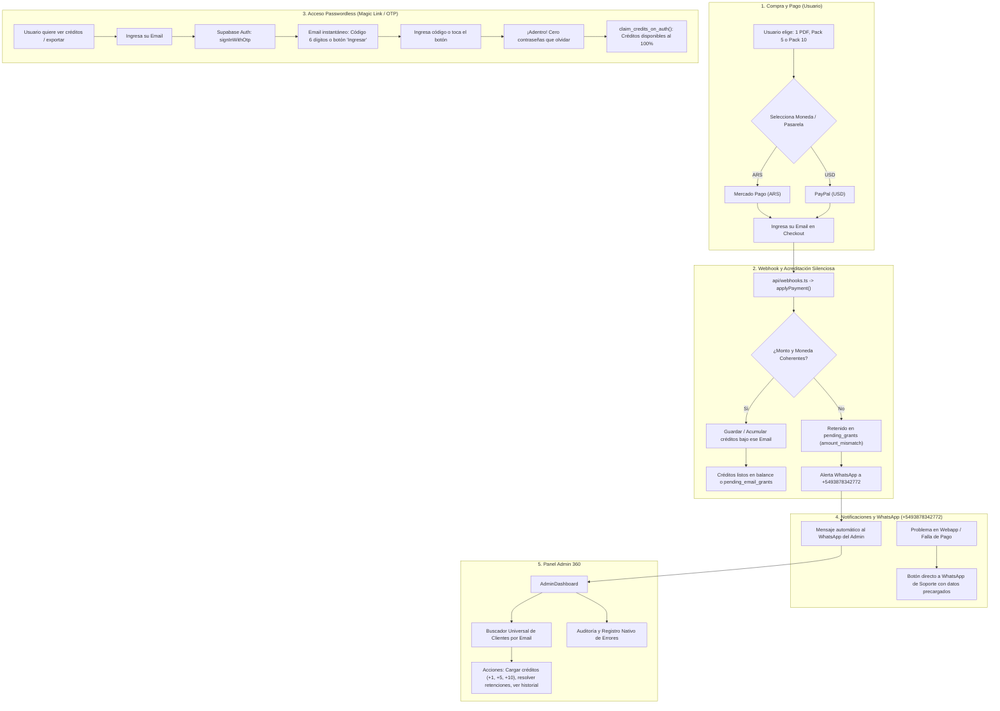
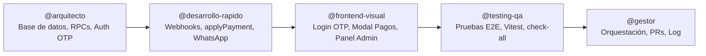

# Plan Maestro: Pagos, Magic Link (Sin Contraseña), Auto-Acreditación, Alertas WhatsApp y Panel Admin LEECV

Este documento define la arquitectura integral y la hoja de ruta de implementación paso a paso para que los agentes especializados de OpenCode (`@gestor`, `@arquitecto`, `@desarrollo-rapido`, `@frontend-visual` y `@testing-qa`) ejecuten la modernización del sistema de cobros, acceso sin fricción y administración de **LEECV**.

---

## 1. Arquitectura de Flujo de Extremo a Extremo

---

## 2. Catálogo Oficial de Precios y Productos

| Producto | Identificador (`id`) | Créditos | Mercado Pago (ARS) | PayPal (USD) | Precio unitario estimado |
|---|---|---|---|---|---|
| **1 Exportación PDF** | `single_pdf` | 1 | **$3.200 ARS** | **$2.60 USD** | $3.200 ARS / $2.60 USD |
| **Pack 5 Créditos** | `credits_pack_5` | 5 | **$12.500 ARS** | **$10.00 USD** | $2.500 ARS / $2.00 USD (-22%) |
| **Pack 10 Créditos** | `credits_pack_10` | 10 | **$21.000 ARS** | **$17.00 USD** | $2.100 ARS / $1.70 USD (-35%) |

> [!NOTE]
> - Se mantienen ocultos los planes de suscripción recurrente en la interfaz de usuario, ofreciendo únicamente los 3 productos directos por créditos.
> - La sincronización entre `src/shared/core/payments/pricingCatalog.ts` y `api/_lib/paymentProviders/pricingCatalog.ts` debe mantenerse estricta mediante `npm run verify:pricing-sync`.

---

## 3. Los 6 Ejes del Sistema

### Eje 1: Cobros y Coherencia de Precios (PayPal y Mercado Pago)
- **Objetivo**: Garantizar cobro exacto y validación estricta de importes.
- **Mercado Pago (`api/_lib/paymentProviders/mercadopago.ts`)**:
  - Preferencia emitida con `unit_price: planData.ars` y `currency_id: 'ARS'`.
- **PayPal (`api/paypal-order.ts` y `api/_lib/paymentProviders/paypal.ts`)**:
  - Orden creada con `value: planData.usd.toFixed(2)` y `currency_code: 'USD'`.
- **Backend `applyPayment.ts`**:
  - Valida que el monto bruto recibido coincida con el plan solicitado. Si no coincide, retiene en `pending_grants` con razón `amount_mismatch` y dispara alerta.

### Eje 2: Acreditación Automática con el Email como Identidad (Auto-Claim)
- **Principio**: El email del usuario es su billetera e identidad digital.
- **Funcionamiento**:
  1. Si el usuario compra sin haber iniciado sesión previa en la web, el pago se valida con su correo (`payer_email`).
  2. Si el perfil ya existe en `profiles`, se le acreditan los tokens de inmediato con la RPC `grant_export_tokens`.
  3. Si aún no existe el perfil, el crédito queda asentado en `unclaimed_email_credits` vinculado al email validado del comprador.
  4. En cuanto el usuario ingresa por primera vez con su email (vía OTP/Magic Link), el sistema ejecuta automáticamente `claim_credits_on_auth(user_email)` y le suma los créditos adquiridos sin intervención manual.

### Eje 3: Autenticación Passwordless (Magic Link o Código de 6 Dígitos)
- **Concepto**: Eliminar 100% las contraseñas para los usuarios de LEECV.
  - El usuario no inventa contraseñas ni tiene que recordarlas.
  - Solo ingresa su correo electrónico.
  - Recibe un correo instantáneo con un código de 6 dígitos (ej. `482910`) y un botón "Ingresar a LEECV".
  - Ingresa el código o hace clic en el enlace y queda autenticado inmediatamente con sus créditos visibles.
- **Ventajas**:
  - Imposible perder la cuenta o los créditos: el acceso siempre está en su bandeja de entrada.
  - Menor fricción y tasa de conversión mucho más alta.
  - Cero tickets o quejas de "olvidé mi contraseña".
- **Implementación técnica**:
  - Uso nativo de Supabase Auth: `supabase.auth.signInWithOtp({ email })`.
  - Verificación del código: `supabase.auth.verifyOtp({ email, token, type: 'email' })`.
  - El acceso administrativo (`AdminLogin.tsx` para Kalpa) se mantiene independiente y protegido con contraseña o lista blanca de correos autorizados.

### Eje 4: Sistema de Notificaciones y WhatsApp (+5493878342772)
- **Estrategia Híbrida de Doble Vía**:
  1. **Vía Cliente ➔ WhatsApp (Soporte Directo)**:
     - Botón de ayuda en modales de pago y en caso de error de exportación:
       `https://wa.me/5493878342772?text=Hola%20LEECV,%20necesito%20ayuda%20con%20mi%20cuenta/exportación.%20Mi%20email%20es%20[EMAIL]`
  2. **Vía Servidor ➔ WhatsApp del Admin (+5493878342772)**:
     - Ante fallas de webhook, discrepancias de montos o pagos retenidos, un despachador en `applyPayment.ts` envía un mensaje al WhatsApp personal del administrador para atención inmediata.
  3. **Vía Panel Admin**:
     - Campana con contador de notificaciones pendientes y listado filtrable.

### Eje 5: Auditoría y Monitoreo de Errores en Panel Admin
- **Problema actual**: `SentryReportsTab.tsx` solo enlaza a un sitio externo.
- **Mejora**: Pestaña interna **"Auditoría y Errores"** (`AuditAndErrorsTab.tsx`) con:
  1. Registro de modificaciones administrativas (`admin_audit_logs`).
  2. Historial de pagos retenidos en `pending_grants` con botón de resolución forzada.
  3. Errores críticos de generación de PDF o llamadas API (`admin_error_logs`).

### Eje 6: El Panel Admin 360° Definitivo
- **Buscador Universal de Clientes por Email**:
  - Permite ingresar cualquier correo y ver en una sola pantalla:
    - Saldo de créditos de exportación actuales.
    - Historial de pagos (Mercado Pago y PayPal).
    - Tokens y exportaciones PDF generadas.
  - **Botones de acción rápida**:
    - `[ +1 Crédito ]` `[ +5 Créditos ]` `[ +10 Créditos ]`
    - `[ Habilitar Exportación de Emergencia ]`
    - `[ Contactar por WhatsApp ]`

---

## 4. Distribución de Tareas por Agente de OpenCode

### Etapa 1: Arquitectura, Base de Datos y Supabase OTP (`@arquitecto`)
1. **Configuración de Autenticación OTP**:
   - Adaptar `src/shared/core/auth/authService.ts` para exponer:
     - `requestOtp(email: string)`
     - `verifyOtp(email: string, token: string)`
   - Mantener login con contraseña restringido únicamente para administradores en `AdminLogin.tsx`.
2. **RPC `grant_export_tokens` & `claim_credits_on_auth`**:
   - Crear migración SQL para la tabla `unclaimed_email_credits(id, email, credits, payment_id, created_at)`.
   - Implementar función SQL `claim_credits_on_auth(p_user_id, p_email)` que traslada los créditos pendientes al balance del usuario al iniciar sesión.
3. **Tabla `admin_error_logs`**:
   - Estructura para capturar excepciones del frontend y webhooks visibles en el panel.

### Etapa 2: Motores de Pago, Webhooks y Alertas WhatsApp (`@desarrollo-rapido`)
1. **Fiscalización de Pasarelas**:
   - `mercadopago.ts` y `paypal.ts`: Verificar lectura exclusiva desde `PRICING_CATALOG`.
2. **Actualización de `applyPayment.ts`**:
   - Integrar la acreditación por email y el guardado en `unclaimed_email_credits` si el usuario aún no tiene perfil.
   - Enviar alerta de WhatsApp a `+5493878342772` ante cualquier retención o anomalía.
3. **Servicio `sendAdminWhatsAppAlert.ts`**:
   - Integración no bloqueante para avisos de servidor al celular del administrador.

### Etapa 3: Interfaz de Usuario, Login Passwordless y Panel Admin (`@frontend-visual`)
1. **Nuevo Flujo de Login Passwordless**:
   - Rediseñar el modal/pantalla de acceso de usuarios:
     - Paso 1: "Ingresá tu email para ver tus créditos y exportar tu CV".
     - Paso 2: "Te enviamos un código de 6 dígitos a tu correo". Input numérico limpio y botón de reenvío.
     - Botón de enlace mágico directo compatible.
2. **Botón de WhatsApp de Soporte en Checkout**:
   - Enlace contextual a `+5493878342772` ante demoras o dudas en el pago.
3. **Renovación del Panel Admin**:
   - Buscador universal por email en `UsersTab.tsx`.
   - Botones rápidos de asignación manual de créditos (`+1`, `+5`, `+10`).
   - Pestaña nativa de Auditoría y Errores (`AuditAndErrorsTab.tsx`).

### Etapa 4: Pruebas No Cosméticas y QA en Navegador (`@testing-qa`)
1. **Pruebas de Pasarela y Webhook**:
   - Test en Vitest de simulación de webhook MP y PayPal para los 3 montos oficiales.
   - Test de idempotencia (mismo `payment_id` dos veces no duplica créditos).
2. **Pruebas de Flujo OTP**:
   - Flujo de ingreso con email, validación de código de 6 dígitos y auto-reclamo de créditos pre-comprados.
3. **Gobernanza `check-all`**:
   - Verificar `npm run check-all` (0 errores de TypeScript, linters, contraste de UI y SEO).

### Etapa 5: Orquestación y Aprobación (`@gestor`)
1. **Creación de ramas y PRs**:
   - `feat/auth-otp-magic-link`
   - `feat/pagos-email-autoclaim`
   - `feat/admin-panel-360`
2. **Verificación final con Kalpa** antes del merge a `main`.

---

## 5. Matriz de Prioridad

| Tarea | Dueño | Prioridad | Esfuerzo | Impacto |
|---|---|---|---|---|
| Autenticación Magic Link / Código OTP al Email | `@arquitecto` + `@frontend-visual` | **P0** | M | Elimina problemas de claves olvidadas y pérdida de créditos |
| Auto-acreditación por Email (sin requerir cuenta previa) | `@arquitecto` + `@desarrollo-rapido` | **P0** | M | El cliente compra y sus créditos ya le pertenecen |
| Verificación estricta de precios ARS/USD en MP y PayPal | `@desarrollo-rapido` + `@testing-qa` | **P0** | S | Cobros 100% exactos y coherentes |
| Botón de WhatsApp de rescate (+5493878342772) para clientes | `@frontend-visual` | **P1** | S | Soporte inmediato ante fallos |
| Alertas automáticas WhatsApp al admin ante pagos retenidos | `@desarrollo-rapido` | **P1** | S | Control en tiempo real desde el celular |
| Buscador de Clientes por Email con gestión de saldo en Admin | `@frontend-visual` | **P1** | M | Gestión ágil para cargar créditos o resolver casos |
| Auditoría y registro de errores nativo en Admin | `@frontend-visual` + `@arquitecto` | **P2** | M | Diagnóstico completo sin depender de herramientas externas |

## 6. Estado de Implementación y Certificación QA

| Etapa | Responsable | Estado | Evidencia / Hash |
|---|---|---|---|
| **Etapa 1: DB/RPC & Auth OTP** | `@arquitecto` | **COMPLETO Y APLICADO** | Migraciones `20261030_*` y `20261031_*` ejecutadas con éxito en Supabase prod (`gzsdmsiefswgnyycrmsk`). PR #52 mergeado (`8681abd`). |
| **Etapa 2: Webhooks & WhatsApp** | `@desarrollo-rapido` | **COMPLETO** | `applyPayment.ts` escribe a `unclaimed_email_credits` para invitados; `dispatchWaAlert` a `+5493878342772`. PR #54 mergeado (`fd20051`). |
| **Etapa 3: UI Login & Admin 360** | `@frontend-visual` | **COMPLETO** | `LoginPasswordlessModal.tsx`, WhatsApp checkout en `PdfCheckoutModal.tsx`, `UsersTab.tsx` (+1/+5/+10), `AuditAndErrorsTab.tsx`. PR #54 mergeado (`fd20051`). |
| **Etapa 4: Batería E2E / QA** | `@testing-qa` | **COMPLETO Y CERTIFICADO** | Suite integral en `tests/planPagosAdminMagicLink.integration.test.ts` (15/15 tests passing, 273/275 tests globales OK). |
| **Etapa 5: Orquestación & Log** | `@gestor` | **COMPLETO** | Trazabilidad histórica asentada en `SESSION_LOG.md` (PR #53 y PR #55). |
