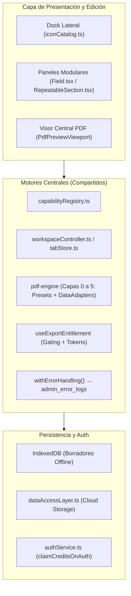

# APP_BLUEPRINT.md — Blueprint Arquitectónico para Apps y Subproductos Nativos en LEECV

Este documento define la **arquitectura estándar, pasos obligatorios y código de andamiaje** para integrar cualquier nueva aplicación, herramienta o tipo de documento en LEECV (ej. cartas, tarjetas, agendas, folletos, diplomas, facturas, menús, presupuestos).

En cumplimiento con la **Regla 10 de `AGENTS.md`**, ninguna app nueva puede ser un desarrollo aislado ("silo"). Toda app nueva se compone a partir de los motores y núcleos canónicos ya probados en producción.

---

## Índice

1. [Visión General de la Arquitectura](#1-visión-general-de-la-arquitectura)
2. [Paso 1: Tipos y Modelo de Datos](#paso-1-tipos-y-modelo-de-datos)
3. [Paso 2: Registro en Capability Registry y Rutas](#paso-2-registro-en-capability-registry-y-rutas)
4. [Paso 3: Formularios y Paneles UI (Sin Inputs a Mano)](#paso-3-formularios-y-paneles-ui-sin-inputs-a-mano)
5. [Paso 4: Motor PDF y Visor en Vivo (Sin Renderers Paralelos)](#paso-4-motor-pdf-y-visor-en-vivo-sin-renderers-paralelos)
6. [Paso 5: Circuito de Créditos, Cobros y Exportación](#paso-5-circuito-de-créditos-cobros-y-exportación)
7. [Paso 6: Persistencia, Tabs y Autoguardado](#paso-6-persistencia-tabs-y-autoguardado)
8. [Paso 7: Trazabilidad, Observabilidad y Errores](#paso-7-trazabilidad-observabilidad-y-errores)
9. [Checklist Obligatorio de Verificación Pre-Merge](#checklist-obligatorio-de-verificación-pre-merge)

---

## 1. Visión General de la Arquitectura



---

## Paso 1: Tipos y Modelo de Datos

Crea o extiende los tipos de tu documento en `src/types/document.ts` o dentro de su módulo en `src/modules/[nombre-app]/types.ts`.

### Reglas:
1. El documento debe contar con un identificador único `id`, un campo de tipo `docType: DocumentTypeId`, un título editable y el `activePresetId`.
2. Extender siempre que sea posible de los bloques canónicos existentes (`PersonalInfo`, `ThemeConfig`, `PrintConfig`).

```typescript
// Ejemplo: src/modules/invoice/types.ts
import { DocumentTypeId } from '../../types/document';

export interface InvoiceItem {
  id: string;
  description: string;
  quantity: number;
  unitPrice: number;
}

export interface InvoiceDocumentData {
  id: string;
  docType: DocumentTypeId; // ej: 'invoice'
  title: string;
  activePresetId: string;
  clientInfo: {
    name: string;
    cuitOrDni: string;
    address: string;
    email: string;
  };
  items: InvoiceItem[];
  notes?: string;
  theme?: {
    primaryColor: string;
    fontFamily: string;
  };
}
```

---

## Paso 2: Registro en Capability Registry y Rutas

El registro central en `src/shared/core/capabilities/capabilityRegistry.ts` es la **única fuente de verdad** para habilitar herramientas en el workspace.

### 2.1 Declarar Capabilities Nuevas (si aplica)
Si la app maneja conceptos no vistos antes (ej. `invoice_items`), se agrega a `CAPABILITY_REGISTRY`:

```typescript
// src/shared/core/capabilities/capabilityRegistry.ts
export const CAPABILITY_REGISTRY: Record<string, CapabilityConfig> = {
  // ...existentes
  invoice_items: {
    id: 'invoice_items',
    name: 'Ítems de Factura',
    description: 'Listado de conceptos facturados, cantidades y precios unitarios.',
    category: 'content',
    defaultData: []
  }
};
```

### 2.2 Registrar el Tipo de Documento
Agregar la entrada en `DOCUMENT_TYPE_REGISTRY`:

```typescript
export const DOCUMENT_TYPE_REGISTRY: Record<string, DocumentTypeConfig> = {
  // ...
  invoice: {
    id: 'invoice',
    name: 'Factura / Presupuesto',
    description: 'Documento comercial profesional imprimible y descargable en PDF.',
    iconName: 'Receipt',
    capabilities: [
      'theme',
      'paper_size',
      'invoice_items',
      'digital_signature',
      'json_backup',
      'nameable_title'
    ],
    defaultPaperSize: 'a4',
    defaultActivePresetId: 'factura-clasica'
  }
};
```

### 2.3 Mapeo de Rutas e Inferencia Heurística
Actualizar en el mismo archivo:
- `getDocTypeForRoute('/crear-factura')`: retorna `'invoice'`.
- `getRouteForDocType('invoice')`: retorna `'/crear-factura'`.
- `getDefaultTitleForDocType('invoice')`: retorna `'Mi Factura Comercial'`.
- `inferDocumentTypeId(docData)`: agregar la regla de discriminación (ej. prefijo `id.startsWith('invoice_')` o `presetId.startsWith('factura-')`).

---

## Paso 3: Formularios y Paneles UI (Sin Inputs a Mano)

**Prohibido usar `<input>`, `<textarea>` o listas `.map()` construidas manualmente con HTML básico.**

### 3.1 Campos Individuales con `<Field />`
Usar `src/shared/core/ui/Field.tsx`:

```tsx
import { Field } from '../../../shared/core/ui/Field';

<Field
  label="Razón Social / Nombre del Cliente"
  value={docData.clientInfo.name}
  onChange={(val) => updateClientField('name', val)}
  placeholder="Ej. Empresa S.A."
  required
/>
```

### 3.2 Listas Dinámicas con `<RepeatableSection />` y `<RecordFormSection />`
Usar las primitivas de `src/shared/core/ui/`:

```tsx
import { RepeatableSection } from '../../../shared/core/ui/RepeatableSection';
import { RecordFormSection } from '../../../shared/core/ui/RecordFormSection';

<RepeatableSection
  title="Detalle de Ítems"
  items={docData.items}
  onAdd={handleAddItem}
  onReorder={handleReorderItems}
  renderItem={(item, index) => (
    <RecordFormSection
      key={item.id}
      title={item.description || `Ítem #${index + 1}`}
      onDelete={() => handleDeleteItem(item.id)}
    >
      <Field
        label="Descripción"
        value={item.description}
        onChange={(v) => updateItem(item.id, 'description', v)}
      />
      <div className="grid grid-cols-2 gap-3">
        <Field
          label="Cantidad"
          type="number"
          value={item.quantity}
          onChange={(v) => updateItem(item.id, 'quantity', Number(v))}
        />
        <Field
          label="Precio Unitario"
          type="number"
          value={item.unitPrice}
          onChange={(v) => updateItem(item.id, 'unitPrice', Number(v))}
        />
      </div>
    </RecordFormSection>
  )}
/>
```

### 3.3 Íconos del Dock
Todos los íconos deben registrarse en `src/shared/core/iconCatalog.ts` para evitar colisiones auditadas por `scripts/check-icon-uniqueness.js`.

---

## Paso 4: Motor PDF y Visor en Vivo (Sin Renderers Paralelos)

**Nunca uses `jspdf` o `html2canvas` directamente en tu app.** Todo documento se genera y previsualiza a través de las capas de `src/shared/core/pdf-engine/`.

### 4.1 Crear el Preset de Diseño
Crear `src/shared/core/pdf-engine/layers/presets/factura-clasica.ts`:

```typescript
import { Preset } from './presetSchema';

export const facturaClasicaPreset: Preset = {
  id: 'factura-clasica',
  name: 'Factura Clásica Comercial',
  category: 'documento',
  targetDocType: 'invoice',
  pageSizeId: 'a4',
  palette: {
    primary: '#1E293B',
    secondary: '#64748B',
    accent: '#0EA5E9',
    text: '#0F172A',
    textOnPrimary: '#FFFFFF',
    background: '#FFFFFF'
  },
  typography: {
    title: 18,
    sectionHeading: 12,
    itemTitle: 10,
    body: 9,
    caption: 8,
    fontFamily: 'Helvetica'
  },
  columnLayout: {
    id: 'single-column',
    name: 'Columna Única Comercial',
    sectionOrder: [
      { sectorRole: 'header', sectionIds: ['client_info'] },
      { sectorRole: 'body', sectionIds: ['invoice_items'] },
      { sectorRole: 'footer', sectionIds: ['totals', 'notes', 'signature'] }
    ]
  }
};
```

### 4.2 Registrar el Preset en `presetRegistry.ts`
En `src/shared/core/pdf-engine/layers/presets/presetRegistry.ts`:
- Importar y registrar `facturaClasicaPreset` en `PRESET_REGISTRY`.

### 4.3 Crear el DataAdapter
Crear un adaptador en `src/shared/core/pdf-engine/layers/records/[app]DataAdapter.ts` que transforme el estado de la app en registros planos (`ContentSection[]` o formato tabular) comprensibles por el motor de render.

### 4.4 Zoom y Controles del Visor
El visor en vivo (`PdfPreviewViewport`) provee automáticamente la barra unificada de herramientas de visualización: **zoom interactivo (+ / - / reset), ajuste automático al ancho de pantalla, vista previa a doble página y centrado reactivo**.
> ⚠️ **Prohibición:** Queda terminantemente prohibido crear botones o estados de zoom independientes en los componentes de la nueva app. Toda la interacción visual se hereda de `PdfPreviewViewport`.

---

## Paso 5: Circuito de Créditos, Cobros y Exportación

**Toda exportación PDF o descarga final consume créditos unificados del usuario.**

### 5.1 Implementar el Handler de Exportación
Usa el hook canónico `useExportEntitlement`:

```tsx
import { useState } from 'react';
import { useExportEntitlement } from '../../../shared/core/entitlements/useExportEntitlement';
import PdfCheckoutModal from '../../cv-builder/components/modals/PdfCheckoutModal';
import { withErrorHandling } from '../../../shared/core/utils/errorHandler';
import { useToast } from '../../../shared/core/ui/Toast';

export function useAppExport(docData: any) {
  const { consumeCreditIfNeeded, loading: isGating } = useExportEntitlement();
  const [isCheckoutOpen, setIsCheckoutOpen] = useState(false);
  const [isExporting, setIsExporting] = useState(false);
  const { showError, showSuccess } = useToast();

  const handleExport = async () => {
    // 1. Gating canónico obligatorio
    const allowed = await consumeCreditIfNeeded();
    if (!allowed) {
      setIsCheckoutOpen(true);
      return;
    }

    // 2. Generación PDF protegida
    setIsExporting(true);
    await withErrorHandling(
      async () => {
        const { exportDocumentToPDF } = await import('../../../shared/core/pdf-engine/pdfExporter');
        await exportDocumentToPDF(docData, docData.activePresetId);
        showSuccess('Documento exportado con éxito en PDF.');
      },
      {
        context: 'Exportación de Factura PDF',
        source: 'pdf',
        errorMessage: 'Ocurrió un error al generar el PDF.',
        notify: (msg) => showError(msg)
      }
    );
    setIsExporting(false);
  };

  return {
    handleExport,
    isExporting,
    isGating,
    isCheckoutOpen,
    setIsCheckoutOpen
  };
}
```

### 5.2 Modal de Checkout Unificado
En el JSX del modal o barra de exportación, invocar `PdfCheckoutModal`:

```tsx
<PdfCheckoutModal
  isOpen={isCheckoutOpen}
  onClose={() => setIsCheckoutOpen(false)}
  onConfirm={handleExport}
  purpose="export"
/>
```

---

## Paso 6: Persistencia, Tabs y Autoguardado

Toda app nueva se almacena en el sistema de workspace multielemento.

1. **Apertura de Documento**: Usar `workspaceController.ensureDocumentTab(docId, 'invoice', initialData)`.
2. **Cierre de Pestaña**: Usar `workspaceController.closeTab(...)`.
3. **Autoguardado**: Cablear `useDraftAutosave(docData, hasChanges, onSave)` para respaldar en IndexedDB automáticamente mientras el usuario escribe.

---

## Paso 7: Trazabilidad, Observabilidad y Errores

Cualquier excepción debe quedar registrada en la tabla `admin_error_logs` mediante `withErrorHandling()`:

```typescript
await withErrorHandling(
  async () => {
    // Acción delicada: llamada a base de datos, parseo JSON, render
  },
  {
    context: 'Carga de presupuesto guardado',
    source: 'frontend',
    errorMessage: 'No se pudo cargar el presupuesto.',
    notify: (msg) => showToast(msg, 'error')
  }
);
```

### Categorías de `source` reconocidas en `admin_error_logs`:
- `'frontend'`: Fallas de interacción o estado del navegador.
- `'pdf'`: Errores durante la compilación o render de capas PDF.
- `'webhook'`: Fallas en notificaciones de pasarelas de pago.
- `'auth'`: Errores en inicio de sesión o reclamo de créditos.
- `'api'`: Respuestas anómalas de endpoints internos.

---

## Paso 8: Integración con IA Unificada y Entrenamiento de Lidio

Toda nueva app que ofrezca asistencia inteligente (autocompletado, sugerencias, redacción asistida, optimización de textos) debe integrarse a la infraestructura central de IA de LEECV.

### 8.1 Cascada Multimodelo y Cero Clientes Paralelos
El backend de LEECV orquesta automáticamente una cascada con rotación y pausas por rate-limit (`ai_key_cooldowns`):
1. **Groq Cloud** (GPT-OSS 120B / Qwen 3.8 Visión)
2. **OpenRouter** (Modelos Libres `:free` como Llama 3.3 70B, Gemini 2.0 Flash Exp)
3. **Google Gemini** (Gemini 1.5 Flash / Pro)

> ⚠️ **Prohibición:** Prohibido instanciar `fetch` directo a endpoints de OpenAI, Gemini o OpenRouter desde el frontend o handlers ad-hoc. Todo se despacha a través de `aiClient.executeAiTask()`.

### 8.2 Registrar Tareas en el Catálogo de IA
Definir las tareas de la nueva app en `api/_lib/aiTasks/catalog.ts`:
- Especificar `taskId`, `buildSystemPrompt`, `buildUserPrompt` y el `responseSchema` validado en JSON.

### 8.3 Entrenamiento Obligatorio de Lidio (`app_guide_assistant`)
Lidio es el asistente universal de LEECV. Para que Lidio no quede desorientado ni invente información cuando el usuario esté en la nueva app:
1. Abrir `api/_lib/aiTasks/catalog.ts` en la tarea `app_guide_assistant`.
2. Agregar el bloque de conocimiento específico de la app:
   - Pestañas o pasos que la componen (ej. `CONOCÉS ESTOS PASOS DE FACTURAS (docType invoice): ...`).
   - Flujo típico de trabajo (ej. `FLUJO TÍPICO FACTURAS: 1. Cargar cliente, 2. Agregar ítems...`).
   - Consejos técnicos y buenas prácticas del documento.

### 8.4 Botones de IA en Formularios con `<AIButton />`
En los paneles de la app, usar el componente estándar `src/shared/core/ui/AIButton.tsx`:

```tsx
import { AIButton } from '../../../shared/core/ui/AIButton';

<AIButton
  label="Mejorar descripción con IA"
  onClick={handleSuggestDescription}
  isLoading={isGenerating}
/>
```

---

## Checklist Obligatorio de Verificación Pre-Merge

Antes de abrir una PR para una nueva app o documento, verifica:

- [ ] **Capability Registry**: ¿Declarado en `DOCUMENT_TYPE_REGISTRY` y `inferDocumentTypeId`?
- [ ] **Gating de Créditos**: ¿La descarga invoca `consumeCreditIfNeeded()` y abre `PdfCheckoutModal` si no hay saldo?
- [ ] **Motor PDF y Zoom**: ¿Usa un `Preset` de `pdf-engine` y se visualiza en `PdfPreviewViewport` heredando zoom y viewport unificados sin controles paralelos?
- [ ] **UI Design System**: ¿Todos los campos usan `<Field />`, `<RepeatableSection />` y tokens CSS sin clases dinámicas de Tailwind (Regla 2)?
- [ ] **Catálogo de Íconos**: ¿Los íconos están registrados en `iconCatalog.ts` sin generar colisiones (`npm run check-icon-uniqueness`)?
- [ ] **Error Handling**: ¿Todas las operaciones async usan `withErrorHandling()` con logs a `admin_error_logs`?
- [ ] **IA y Asistente Lidio**: ¿Las tareas de IA están registradas en `catalog.ts`, usan `<AIButton />` y se entrenó a Lidio en `app_guide_assistant` con el bloque de conocimiento de la app?
- [ ] **Regla 0**: ¿`npm run check-all` da exactamente **0 errores**?
- [ ] **Versionado**: ¿Se incrementó la versión en `src/shared/core/version.ts` (Regla 6)?
