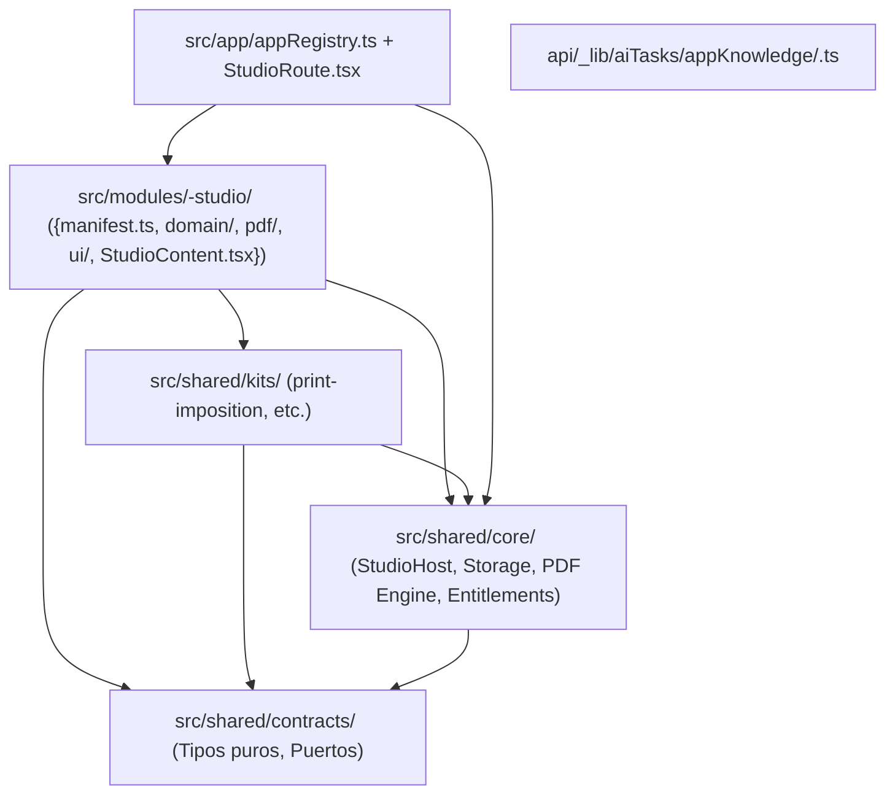

# APP_BLUEPRINT.md — Blueprint de Cápsulas Verticales para Apps en LEECV

Este documento define el estándar oficial (Fases 0–10) para crear e integrar una nueva aplicación como **cápsula vertical aislada** sin modificar código común del tronco (`src/shared/`).

---

## 1. Arquitectura de Cápsula Vertical



### Reglas estructurales (auditadas por AST en CI)
- **`src/shared/contracts/**`**: 0 dependencias externas o internas.
- **`src/shared/core/**`**: no importa `modules/`, `kits/`, `app/` ni `context/`/`data/`.
- **`src/modules/<app>/domain/**`**: JavaScript/TypeScript puro (`[domain-purity]`: prohibido `react`, `react-dom`, `@react-pdf/renderer`, `./ui/`).
- **`src/modules/<app>/manifest.ts`**: metadatos puros de cápsula (`[manifest-purity]`: solo importa `src/shared/contracts`).
- **0 cross-module imports**: ninguna app importa desde otra app. Para compartir datos entre apps (como CV → Tarjeta Personal), usar puertos tipados vía `portBroker.ts`.

---

## 2. Paso 1 — Generar el esqueleto con `npm run new-app`

```bash
npm run new-app -- \
  --id=diploma \
  --capsule=diploma-studio \
  --route=/crear-diploma \
  --title="Diplomas y Certificaciones" \
  --storage=local-only \
  --privacy=full-summary
```

Esto genera:
- `src/modules/<capsule>/manifest.ts`
- `src/modules/<capsule>/domain/<id>Types.ts`
- `src/modules/<capsule>/domain/<id>StepSequence.ts`
- `src/modules/<capsule>/<Pascal>StudioContent.tsx`
- Carpetas `pdf/` y `ui/`

Para previsualizar sin escribir archivos: agregar `--dry-run`.

---

## 3. Paso 2 — Declarar el Contrato en Registros (`C`)

1. **`src/shared/core/capabilities/capabilityRegistry.ts`** (`DOCUMENT_TYPE_REGISTRY`):
   - `id`, `capsuleId`, `name`, `description`, `iconName`, `route`, `defaultTitle`, `titlePrefix`, `draftIdPrefix`.
   - `storage`:
     - `{ kind: 'local' }` (solo en este dispositivo)
     - `{ kind: 'local', cloudBackup: { projection: 'structured-text', maxBytes: 16384 } }` (respaldo opt-in sin imágenes)
     - `{ kind: 'local-encrypted', encryptedDriver: 'vault-aes-gcm' }` (bóveda cifrada 100% local, nunca nube)
   - `assistant`: `{ knowledgeId, privacy: 'full-summary' | 'metadata-only' }`
   - `creationStrategy`, `capabilities`, `exportFormats`, `stepSequenceId`, `defaultPaperSize`, `defaultActivePresetId`.
2. **`src/shared/core/capabilities/appSurfaceManifest.ts`** (`APP_SURFACE_MANIFEST`):
   - `route`, `primaryStudioFile`, `menuAction`, `tabsBarAction`, `features`, `requiredFiles`.
3. **`src/app/appRegistry.ts`** (`APP_REGISTRY` + `registerAllDockProviders()`):
   - Registrar el proveedor del Dock (`registerDockStepProvider` + `registerStepIds`).
   - Montar el componente `lazy(...)` con `usesSharedCvWorkspace: false`.

---

## 4. Paso 3 — Render y Exportación PDF sin tocar `pdfExporter.ts`

1. Colocar los componentes `@react-pdf/renderer`, presets y adaptadores dentro de `src/modules/<capsule>/pdf/`.
2. Registrar el exportador de categoría desde el propio documento PDF:
   ```ts
   import { registerPdfCategoryExporter } from '../../../shared/core/pdf-engine/pdfCategoryRegistry';
   ```
3. Toda descarga pagada o con créditos usa `useExportEntitlement()` (`consumeCreditIfNeeded()`) junto a `<PdfCheckoutModal />` importado desde `src/shared/core/studio-host/PdfCheckoutModal`.
4. Previsualizar en vivo dentro de `<VectorDocViewer />` importando el componente `@react-pdf/renderer` directamente (nunca con `React.lazy`, para preservar su reconciler propio).

---

## 5. Paso 4 — Persistencia Local-First, UI Cero Ruido, Taxonomía de Botones y Cascada Anti-Pisado

- **3 Canales de Ayuda (Estándar Cero Ruido)**:
  - **Ayuda de control bajo demanda (`<LidioHelpTrigger />` `?` dentro de `<PanelSection helpText="..." />`)**: explica *para qué sirve* un botón, interruptor o filtro sin llenar el panel de párrafos.
  - **Guía contextual de redacción (`<ContextualGuideBox />`)**: siempre visible únicamente cuando el usuario necesita saber *qué escribir o cargar*.
  - **Confirmación de estado (`lidioBus.ts` vía `<SectionSwitch />` y `<VisibilityEyeToggle />`)**: al pausar u ocultar un bloque, tranquiliza asegurando que ningún dato se borra.
- **Taxonomía Visual de Botones y Dock Compacto (2 columnas)**:
  - **En `StudioDock` (`DockButtonRole`)**: usar botones compactos (`isLarge: false`) en grilla de 2 columnas para ver secciones/capítulos diferenciados de un vistazo. Cada paso DEBE declarar `role`: `'catalog'` (verde, catálogo), `'preset'` (acento principal, configuración/estilo), `'record'` (neutro/secundario, contenido/ítems), `'custom_record'` (violeta suave, bloques propios / `+` siempre al final), `'ai_utility'` (violeta discontinuo, importar / IA al principio) o `'handoff'` (ámbar, salto a otra app; si es global, va en `globalActions` de barra superior). `StudioDock` inserta separadores `--ui-dock-separator` entre grupos (`config` / `records` / `tools`).
  - **En paneles (`UiButtonRole`)**: usar `<ActionGrid />` + `<ActionTileButton role="..." />` (`'preset' | 'record' | 'io' | 'export_paid' | 'ai' | 'handoff' | 'destructive'`) y `<AIButton />` (ícono animado), sin párrafos descriptivos dentro del botón (usar `helpText` → `?`).
- **Barra Superior (4 Zonas), Píldoras Globales (1 eje = 1 modal) y Anti-Duplicación**:
  - **Presupuesto TopBar (`TOPBAR_BUDGET`)**: Zona izquierda (archivo, zoom, undo/redo) · Zona centro (`globalContextPills`, máx. **3**, un eje global por píldora) · Zona acciones globales (`globalActions`, máx. **2**, ej. Carta / ATS) · Zona derecha (Guardar, Cuenta & Preferencias con tema `Día / Noche / Océano / Ink`, Créditos, Exportar). En móvil, el editor se abre desde el Dock y la barra superior muestra únicamente **Ver** mientras `isPanelOpen` está activo.
  - **Regla anti emoji+ícono**: nunca combinar `icon`/`iconId` SVG con un emoji en la misma etiqueta visible (usar `ICON_REGISTRY` / `iconId` único y texto limpio).
  - **Regla 1 Modal = 1 Eje y Cero Duplicación Modal ↔ Panel / Panel ↔ Panel**: un cambio global vive en TopBar + su modal enfocado; los paneles no repiten grillas de presets globales ni editan campos que ya pertenecen a otro paso (muestran estado + enlace al paso o modal dueño).
  - **Cascada de 3 Niveles (`configCascadeEngine.ts`)**: **Nivel 1 (Global) → Nivel 2 (Preset) → Nivel 3 (`manualOverrides`)** garantiza que nunca se pisan ajustes finos sin preguntar (`detectGlobalConflicts` + `applyGlobalConfigWithCascade`), mostrando `<ManualOverrideBadge />` con reset puntual (`↺`).
- **Persistencia en Disco, Respaldo ante Actualizaciones y Carpeta Segura**:
  - Toda persistencia pasa por `documentStorageService` (`localDocumentStore` + `wrapDocumentEnvelope`) y exportación a disco por `nativeFileDocumentService.ts` + `fileHandleStore.ts` ("Carpeta Segura").
  - Toda app standalone protege cambios recientes con `useUnsavedChangesGuard` (`beforeunload` + flush antes de actualizar el Service Worker vía `updateEngine.ts`) y puede alimentar el semáforo `backupHealth` de `StudioNavbar`.
  - Los buscadores de catálogos, clientes o historial usan `<SearchFilterBar minChars={3} />` (`matchesSearchQuery` con normalización NFD).
  - Toda importación/estructuración asistida por IA usa `<StructuredImportReviewModal />` diferenciando campos 1:1 de registros/capítulos y mostrando retención.
  - Los archivos binarios/imágenes se externalizan automáticamente a IndexedDB (`localAssetStore`, URI `asset://<sha256>` con conteo de referencias al borrar).
  - Las fuentes tipográficas universitarias y personalizadas para PDF se resuelven bajo demanda mediante `academicFontCatalog.ts` + `localFontStore.ts` + `pdfFontRegistry.ts` (`ensureAcademicOrCustomFontRegistered`).
  - Registrar sanitizador y migrador propios vía `registerDocumentSchemaHandler(docType, handler)` sin depender de `migrateCvData`.
  - Cualquier operación async de usuario usa `withErrorHandling()` (`errorHandler.ts`).

---

## 6. Paso 5 — Lidio Modular y Privacidad

1. Crear `api/_lib/aiTasks/appKnowledge/<id>.ts` e incluirlo en `api/_lib/aiTasks/appKnowledge/index.ts`.
2. Agregar tips locales por paso y generales en `src/shared/core/assistant/assistantTips.ts`.
3. Para apps sensibles (`metadata-only`, como FacturLee), entregar a `<FloatingAssistant metadataOnlyContext={...} />` únicamente metadatos de completitud sin valores escritos por el usuario.

---

## 7. Checklist Final antes de abrir PR

- `npm run check-all` en **0 errores**:
  - `verify:registry-coverage`, `verify:app-mounted`, `verify:app-contract`, `new-app:selftest`
  - `check-import-graph` (**0** violaciones AST, **0** ciclos runtime)
  - `check-docType-leaks` (**0** fugas nuevas)
  - `check-forbidden-doctypes` (sin tipos purgados)
  - `check-ui-tokens`, `check-contrast`, `check-plain-language`, `check-bundle-budget`, `verify:seo`
- Actualización de versión en `src/shared/core/version.ts` (`check-version-bump`).
